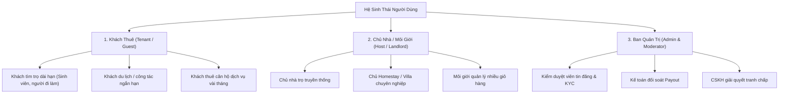
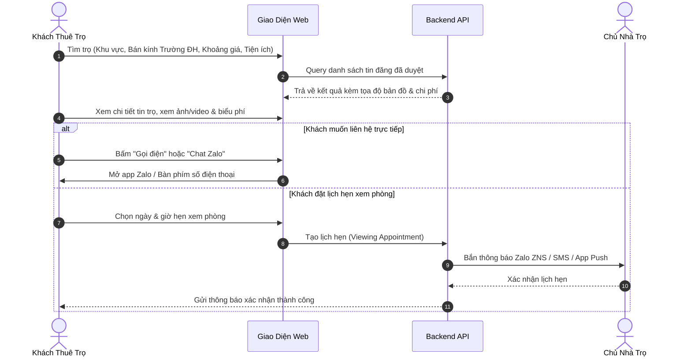
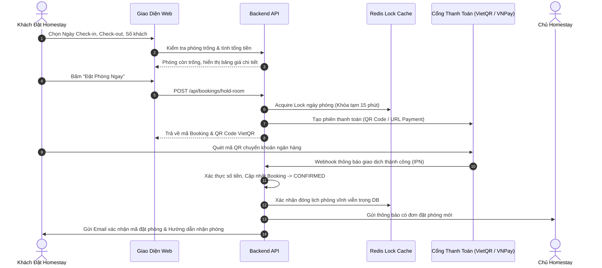

# ĐẶC TẢ YÊU CẦU NGHIỆP VỤ HỆ THỐNG (SRS)
## HYBRID RENTAL PLATFORM: PHÒNG TRỌ DÀI HẠN & HOMESTAY NGẮN HẠN

---

## 1. MỤC TIÊU DỰ ÁN & BÀI TOÁN KINH DOANH

### 1.1. Hiện trạng thị trường
- Các nền tảng hiện nay phân tách rạch ròi:
  - **Nhóm 1 (Rao vặt truyền thống như Nhà Tốt, Phongtro123, Batdongsan):** Mạnh về phòng trọ dài hạn nhưng trải nghiệm đặt phòng kém, thông tin giá cả thường không minh bạch (giá ảo), chủ yếu phụ thuộc vào gọi điện/Zalo, không có giữ chỗ hay bảo lãnh thanh toán.
  - **Nhóm 2 (OTA quốc tế như Agoda, Booking.com, Airbnb):** Trải nghiệm đặt phòng và thanh toán cực tốt nhưng phí hoa hồng cao (15% - 20%), không phục vụ khách thuê trọ dài hạn sinh viên/người đi làm, quy trình ký gửi phức tạp.
- **Cơ hội:** Xây dựng một nền tảng "All-in-One" tại Việt Nam cho phép người dùng vừa tìm phòng trọ dài hạn với đầy đủ thông tin chuẩn hóa, vừa có thể thuê homestay/căn hộ dịch vụ ngắn hạn với trải nghiệm đặt phòng, lịch phòng và thanh toán chuẩn quốc tế như Agoda.

### 1.2. Mục tiêu chiến lược
1. **Minh bạch hóa chi phí:** Hiển thị rõ giá thuê, chi phí phụ trợ (điện, nước, internet, rác, gửi xe) đối với phòng trọ dài hạn.
2. **Trải nghiệm đặt phòng chuẩn OTA:** Hỗ trợ xem phòng trống theo lịch, tính tổng giá tiền gồm phụ phí/dịch vụ, thanh toán cọc tức thì hoặc quét QR đối với homestay.
3. **Phù hợp thói quen người Việt:** Đăng nhập qua số điện thoại/OTP/Google, thanh toán qua QR Chuyển khoản (VietQR / MoMo / VNPay), tích hợp nút gọi điện / Zalo nhanh.

---

## 2. ĐỐI TƯỢNG NGƯỜI DÙNG (USER PERSONAS)

---

## 3. PHÂN TÍCH TÍNH NĂNG CHI TIẾT THEO 2 MÔ HÌNH

### 3.1. Phân hệ 1: Cho Thuê Phòng Trọ Dài Hạn (Mô hình Nhà Tốt / Chợ Tốt)

| Tính Năng | Mô Tả Nghiệp Vụ Chi Tiết | Yêu Cầu Kỹ Thuật |
|:---|:---|:---|
| **Đăng tin phòng trọ** | Chọn loại hình: Phòng trọ khép kín, Chung cư mini, Nhà nguyên căn, Ở ghép (Sleepbox/Dorm). Nhập giá/tháng, tiền cọc (thường 1 tháng). | Upload tối đa 15 ảnh + 1 video ngắn. Validate số điện thoại. |
| **Bảng chi phí cố định & biến đổi** | Bắt buộc kê khai: Giá điện (đ/kWh), nước (đ/khối hoặc đ/người/tháng), rác, wifi, xe máy. | Tính toán chi phí ước tính trung bình 1 tháng cho khách xem trước. |
| **Tiện ích phòng trọ** | Checkbox tiện nghi: Gác lửng, ban công, máy lạnh, máy giặt, kệ bếp, WC riêng, bảo vệ 24/7, giờ giấc tự do, thang máy, cho nuôi thú cưng. | Bộ lọc đa tiêu chí (Multi-filter) tối ưu hóa truy vấn DB. |
| **Bộ lọc & Định vị vị trí** | Tìm kiếm theo Tỉnh/TP -> Quận/Huyện -> Phường/Xã -> Đường phố. Tìm theo bán kính trường Đại học / Bệnh viện / KCN (VD: Bán kính 3km quanh ĐH Bách Khoa). | Sử dụng PostGIS `ST_DWithin` kết hợp bản đồ Leaflet/Mapbox. |
| **Liên hệ & Đặt lịch xem phòng** | Nút bấm "Gọi ngay", "Nhắn Zalo", "Chat trên hệ thống". Tính năng "Hẹn giờ đến xem phòng" (gửi thông báo về Zalo/SMS cho chủ trọ). | Chống click spam số điện thoại, ghi nhận Lead cho chủ nhà. |
| **Gói dịch vụ đẩy tin (Monetization)** | Gói VIP Kim Cương, VIP Vàng, Đẩy tin tự động mỗi ngày (Auto-bump), Nhãn "Đã xác thực chính chủ". | Cổng thanh toán nạp tiền vào ví hệ thống hoặc quét QR trực tiếp. |

---

### 3.2. Phân hệ 2: Cho Thuê Homestay Ngắn Hạn (Mô hình Agoda / Airbnb)

| Tính Năng | Mô Tả Nghiệp Vụ Chi Tiết | Yêu Cầu Kỹ Thuật |
|:---|:---|:---|
| **Bộ tìm kiếm ngày & khách** | Chọn Ngày Check-in, Ngày Check-out, Số lượng khách (Người lớn, trẻ em). Hệ thống chỉ hiển thị các căn còn phòng trống trong toàn bộ dải ngày đó. | Truy vấn kiểm tra giao khoảng thời gian (Date Range Overlap Check) cực nhanh. |
| **Lịch phòng trống & Giá linh hoạt** | Chủ nhà có lịch tháng (Calendar View): Set giá ngày thường, giá Thứ 6 - Thứ 7, giá ngày Lễ/Tết. Có thể đóng phòng (Block dates) thủ công. | Bảng `room_calendar_pricing` lưu giá và trạng thái từng ngày. |
| **Quy trình Đặt phòng (Booking Flow)** | Bước 1: Chọn ngày & số khách -> Bước 2: Tóm tắt chi phí (Giá phòng x số đêm + Phí vệ sinh + Thuế/Phí dịch vụ) -> Bước 3: Điền thông tin khách -> Bước 4: Thanh toán. | State Machine quản lý trạng thái: `PENDING_PAYMENT` -> `CONFIRMED` -> `CHECKED_IN` -> `COMPLETED`. |
| **Chế độ Đặt tức thì & Chờ duyệt** | - **Instant Book:** Thanh toán thành công là có phòng ngay (chuẩn Agoda). - **Request to Book:** Chủ nhà có 12 tiếng để chấp nhận/từ chối trước khi trừ tiền. | Queue hẹn giờ tự động hủy (Auto-cancel timeout) nếu quá hạn thanh toán/phê duyệt. |
| **Cơ chế Chống Double-Booking** | Khi có 2 khách cùng bấm thanh toán 1 phòng vào cùng 1 thời điểm: Chỉ người thanh toán đầu tiên giữ phòng. | Sử dụng **Redis Redlock / Optimistic Locking** khóa ngày đặt phòng trong 15 phút thanh toán. |
| **Chính sách hủy phòng (Cancellation)** | Cấu hình: Linh hoạt (Hủy miễn phí trước 24h), Trung bình (Hủy trước 5 ngày hoàn 100%), Nghiêm ngặt (Không hoàn tiền hoặc hoàn 50%). | Cronjob tự động tính toán số tiền hoàn dựa trên policy và tạo lệnh Refund. |
| **Đánh giá xác thực (Verified Reviews)** | Chỉ khách đã hoàn thành chuyến đi (Status `COMPLETED`) mới được đánh giá từ 1 - 5 sao và nhận xét chi tiết (Độ sạch sẽ, Vị trí, Chủ nhà...). | Ngăn chặn hoàn toàn đánh giá ảo, nâng cao độ uy tín nền tảng. |

---

## 4. QUY TRÌNH NGHIỆP VỤ CỐT LÕI (CORE WORKFLOWS)

### 4.1. Luồng Người Dùng Tìm & Thuê Phòng Trọ (Long-term Flow)

### 4.2. Luồng Đặt Phòng Homestay & Thanh Toán Trực Tuyến (Short-term Flow)

---

## 5. MÔ HÌNH DOANH THU CỦA NỀN TẢNG (BUSINESS REVENUE MODEL)

1. **Phí hoa hồng đặt Homestay (Commission Fee):**
   - Thu 8% - 12% trên mỗi giao dịch đặt phòng thành công (thấp hơn Agoda/Airbnb ở mức 15-20% để cạnh tranh).
   - Hệ thống tự động khấu trừ hoa hồng trước khi Payout doanh thu cho Chủ Homestay định kỳ (hàng tuần hoặc ngày mùng 1 & 15).
2. **Gói Dịch Vụ Đăng Tin Phòng Trọ:**
   - **Gói Miễn phí:** Đăng tối đa 2 tin thường, hiển thị theo thời gian đăng.
   - **Gói Đẩy tin (Bump coin):** 10.000đ - 20.000đ / lần đẩy tin lên trang đầu.
   - **Gói VIP 1 / VIP 2 / VIP Kim Cương:** 100.000đ - 500.000đ / tháng (Ghim đầu trang, gắn nhãn Nổi bật, hiển thị màu sắc bắt mắt).
3. **Phí Xác Thực Chính Chủ (Verified Badge):**
   - Đội ngũ kiểm tra thực tế hoặc xác thực sổ đỏ/CCCD/hợp đồng điện nước: 150.000đ / phòng (gắn tick xanh tăng uy tín chuyển đổi khách thuê).
