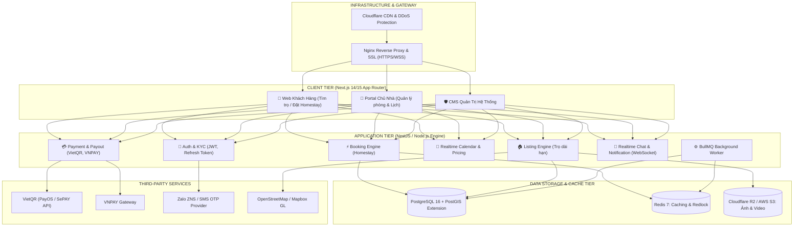
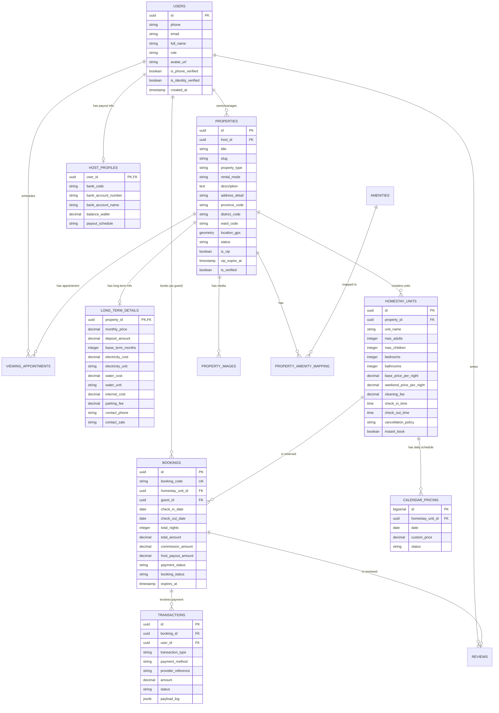
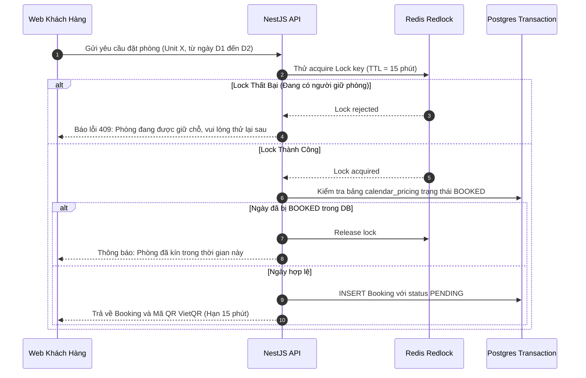

# THIẾT KẾ KIẾN TRÚC HỆ THỐNG & CƠ SỞ DỮ LIỆU
## HYBRID RENTAL PLATFORM (PHÒNG TRỌ & HOMESTAY)

---

## 1. TỔNG QUAN KIẾN TRÚC HỆ THỐNG (SYSTEM ARCHITECTURE)

Hệ thống được thiết kế theo kiến trúc **Modular Monolith** kết hợp **Background Event Queues**, tối ưu nhất cho đội ngũ 2 lập trình viên: dễ triển khai, dễ test, loại bỏ độ phức tạp của Microservices nhưng vẫn đảm bảo khả năng mở rộng (scale) lên hàng triệu người dùng khi cần.



---

## 2. THIẾT KẾ CƠ SỞ DỮ LIỆU (DATABASE SCHEMA - POSTGRESQL + POSTGIS)

Hệ thống sử dụng **PostgreSQL 16** với extension **`postgis`** để định vị không gian và **`uuid-ossp`** cho ID duy nhất.

### 2.1. Sơ đồ thực thể quan hệ (ERD Diagram)



---

### 2.2. Chi Tiết Các Bảng SQL Cốt Lõi (PostgreSQL DDL)

```sql
-- Kích hoạt extension PostGIS và UUID
CREATE EXTENSION IF NOT EXISTS "uuid-ossp";
CREATE EXTENSION IF NOT EXISTS "postgis";

-- 1. Bảng Người Dùng (Users)
CREATE TABLE users (
    id UUID PRIMARY KEY DEFAULT uuid_generate_v4(),
    phone VARCHAR(20) UNIQUE NOT NULL,
    email VARCHAR(255) UNIQUE,
    password_hash VARCHAR(255) NOT NULL,
    full_name VARCHAR(150) NOT NULL,
    role VARCHAR(20) NOT NULL DEFAULT 'TENANT', -- 'TENANT', 'HOST', 'ADMIN'
    avatar_url TEXT,
    is_phone_verified BOOLEAN DEFAULT FALSE,
    is_identity_verified BOOLEAN DEFAULT FALSE,
    status VARCHAR(20) DEFAULT 'ACTIVE', -- 'ACTIVE', 'BANNED'
    created_at TIMESTAMP WITH TIME ZONE DEFAULT CURRENT_TIMESTAMP,
    updated_at TIMESTAMP WITH TIME ZONE DEFAULT CURRENT_TIMESTAMP
);

-- 2. Bảng Bất Động Sản (Properties)
CREATE TABLE properties (
    id UUID PRIMARY KEY DEFAULT uuid_generate_v4(),
    host_id UUID NOT NULL REFERENCES users(id) ON DELETE CASCADE,
    title VARCHAR(255) NOT NULL,
    slug VARCHAR(300) UNIQUE NOT NULL,
    property_type VARCHAR(50) NOT NULL, -- 'PHONG_TRO', 'CHUNG_CU_MINI', 'NHA_NGUYEN_CAN', 'HOMESTAY', 'VILLA'
    rental_mode VARCHAR(30) NOT NULL,   -- 'LONG_TERM', 'SHORT_TERM', 'HYBRID'
    description TEXT NOT NULL,
    address_detail VARCHAR(255) NOT NULL,
    province_code VARCHAR(20) NOT NULL,
    district_code VARCHAR(20) NOT NULL,
    ward_code VARCHAR(20) NOT NULL,
    latitude DOUBLE PRECISION NOT NULL,
    longitude DOUBLE PRECISION NOT NULL,
    location GEOMETRY(Point, 4326),     -- Tọa độ PostGIS để tìm kiếm theo bán kính
    status VARCHAR(30) DEFAULT 'PENDING_REVIEW', -- 'DRAFT', 'PENDING_REVIEW', 'PUBLISHED', 'REJECTED', 'HIDDEN'
    is_vip BOOLEAN DEFAULT FALSE,
    vip_expire_at TIMESTAMP WITH TIME ZONE,
    is_verified BOOLEAN DEFAULT FALSE,
    view_count INT DEFAULT 0,
    created_at TIMESTAMP WITH TIME ZONE DEFAULT CURRENT_TIMESTAMP,
    updated_at TIMESTAMP WITH TIME ZONE DEFAULT CURRENT_TIMESTAMP
);

-- Tự động cập nhật cột Point Geometry khi INSERT hoặc UPDATE
CREATE OR REPLACE FUNCTION update_property_location()
RETURNS TRIGGER AS $$
BEGIN
    NEW.location = ST_SetSRID(ST_MakePoint(NEW.longitude, NEW.latitude), 4326);
    RETURN NEW;
END;
$$ LANGUAGE plpgsql;

CREATE TRIGGER trg_update_property_location
BEFORE INSERT OR UPDATE ON properties
FOR EACH ROW EXECUTE FUNCTION update_property_location();

-- Tạo Spatial Index tối ưu truy vấn vị trí
CREATE INDEX idx_properties_location ON properties USING GIST(location);
CREATE INDEX idx_properties_rental_mode ON properties(rental_mode);
CREATE INDEX idx_properties_status ON properties(status);

-- 3. Bảng Chi Tiết Cho Thuê Dài Hạn (Long-term / Phòng Trọ)
CREATE TABLE long_term_details (
    property_id UUID PRIMARY KEY REFERENCES properties(id) ON DELETE CASCADE,
    monthly_price NUMERIC(15, 2) NOT NULL,      -- Giá thuê hàng tháng
    deposit_amount NUMERIC(15, 2) NOT NULL,     -- Tiền cọc
    lease_term_months INT DEFAULT 6,            -- Hạn hợp đồng tối thiểu (tháng)
    area_sqm NUMERIC(6, 2) NOT NULL,            -- Diện tích m2
    electricity_cost NUMERIC(12, 2) NOT NULL,   -- Giá điện (đ/kWh)
    water_cost NUMERIC(12, 2) NOT NULL,         -- Giá nước (đ/m3 hoặc đ/người)
    water_unit VARCHAR(20) DEFAULT 'M3',        -- 'M3' hoặc 'PERSON'
    internet_cost NUMERIC(12, 2) DEFAULT 0,
    parking_fee NUMERIC(12, 2) DEFAULT 0,
    contact_phone VARCHAR(20) NOT NULL,
    contact_zalo VARCHAR(20),
    allow_pets BOOLEAN DEFAULT FALSE
);

-- 4. Bảng Đơn Vị Phòng Homestay (Homestay Units)
CREATE TABLE homestay_units (
    id UUID PRIMARY KEY DEFAULT uuid_generate_v4(),
    property_id UUID NOT NULL REFERENCES properties(id) ON DELETE CASCADE,
    unit_name VARCHAR(150) NOT NULL,            -- Tên phòng / Tên căn
    max_adults INT NOT NULL DEFAULT 2,
    max_children INT NOT NULL DEFAULT 1,
    bedrooms INT NOT NULL DEFAULT 1,
    bathrooms INT NOT NULL DEFAULT 1,
    base_price_per_night NUMERIC(15, 2) NOT NULL,
    weekend_price_per_night NUMERIC(15, 2),     -- Giá thứ 6, thứ 7
    cleaning_fee NUMERIC(12, 2) DEFAULT 0,
    check_in_time TIME DEFAULT '14:00:00',
    check_out_time TIME DEFAULT '12:00:00',
    cancellation_policy VARCHAR(30) DEFAULT 'FLEXIBLE', -- 'FLEXIBLE', 'MODERATE', 'STRICT'
    instant_book BOOLEAN DEFAULT TRUE,
    created_at TIMESTAMP WITH TIME ZONE DEFAULT CURRENT_TIMESTAMP
);

-- 5. Bảng Lịch Đặt Phòng & Giá Từng Ngày (Homestay Calendar Pricing)
CREATE TABLE calendar_pricing (
    id BIGSERIAL PRIMARY KEY,
    homestay_unit_id UUID NOT NULL REFERENCES homestay_units(id) ON DELETE CASCADE,
    date DATE NOT NULL,
    custom_price NUMERIC(15, 2),
    status VARCHAR(20) DEFAULT 'AVAILABLE', -- 'AVAILABLE', 'BLOCKED', 'BOOKED'
    CONSTRAINT uq_unit_date UNIQUE (homestay_unit_id, date)
);
CREATE INDEX idx_calendar_unit_date ON calendar_pricing(homestay_unit_id, date);

-- 6. Bảng Đơn Đặt Phòng (Bookings)
CREATE TABLE bookings (
    id UUID PRIMARY KEY DEFAULT uuid_generate_v4(),
    booking_code VARCHAR(32) UNIQUE NOT NULL,   -- Mã đơn (VD: AG-2026-X89K)
    homestay_unit_id UUID NOT NULL REFERENCES homestay_units(id),
    guest_id UUID NOT NULL REFERENCES users(id),
    check_in_date DATE NOT NULL,
    check_out_date DATE NOT NULL,
    total_nights INT NOT NULL,
    num_adults INT NOT NULL DEFAULT 1,
    num_children INT NOT NULL DEFAULT 0,
    base_amount NUMERIC(15, 2) NOT NULL,
    cleaning_fee NUMERIC(15, 2) DEFAULT 0,
    service_fee NUMERIC(15, 2) DEFAULT 0,
    total_amount NUMERIC(15, 2) NOT NULL,       -- Tổng tiền khách phải trả
    commission_rate NUMERIC(5, 2) DEFAULT 10.0, -- Tỷ lệ hoa hồng (%)
    commission_amount NUMERIC(15, 2) NOT NULL,  -- Tiền hoa hồng sàn giữ
    host_payout_amount NUMERIC(15, 2) NOT NULL, -- Tiền thanh toán cho chủ nhà
    payment_status VARCHAR(30) DEFAULT 'PENDING', -- 'PENDING', 'PAID', 'REFUNDED'
    booking_status VARCHAR(30) DEFAULT 'PENDING_CONFIRMATION', -- 'PENDING_CONFIRMATION', 'CONFIRMED', 'CHECKED_IN', 'COMPLETED', 'CANCELLED'
    cancellation_reason TEXT,
    guest_notes TEXT,
    expires_at TIMESTAMP WITH TIME ZONE NOT NULL, -- Thời hạn hoàn tất thanh toán (15 phút)
    created_at TIMESTAMP WITH TIME ZONE DEFAULT CURRENT_TIMESTAMP,
    updated_at TIMESTAMP WITH TIME ZONE DEFAULT CURRENT_TIMESTAMP
);

-- 7. Bảng Lịch Hẹn Xem Phòng Trọ (Viewing Appointments)
CREATE TABLE viewing_appointments (
    id UUID PRIMARY KEY DEFAULT uuid_generate_v4(),
    property_id UUID NOT NULL REFERENCES properties(id) ON DELETE CASCADE,
    tenant_id UUID NOT NULL REFERENCES users(id),
    tenant_name VARCHAR(150) NOT NULL,
    tenant_phone VARCHAR(20) NOT NULL,
    scheduled_date DATE NOT NULL,
    scheduled_time TIME NOT NULL,
    status VARCHAR(30) DEFAULT 'PENDING', -- 'PENDING', 'ACCEPTED', 'REJECTED', 'COMPLETED', 'CANCELLED'
    notes TEXT,
    created_at TIMESTAMP WITH TIME ZONE DEFAULT CURRENT_TIMESTAMP
);
```

---

## 3. GIẢI PHÁP KỸ THUẬT QUAN TRỌNG

### 3.1. Chống Trùng Phòng Homestay (Double-Booking Prevention)
Vấn đề nhức nhối nhất của các hệ thống OTA là khi có nhiều khách cùng bấm đặt 1 phòng trong cùng khoảng ngày.



### 3.2. Truy Vấn Tìm Kiếm Vị Trí Địa Lý (PostGIS Spatial Radius Query)
Ví dụ tìm phòng trọ hoặc Homestay trong **bán kính 3 km** quanh vị trí ĐH Bách Khoa (10.7725, 106.6578), sắp xếp từ gần đến xa:

```sql
SELECT 
    p.id,
    p.title,
    p.property_type,
    p.rental_mode,
    ltd.monthly_price,
    ST_Distance(
        p.location::geography,
        ST_SetSRID(ST_MakePoint(106.6578, 10.7725), 4326)::geography
    ) AS distance_meters
FROM properties p
LEFT JOIN long_term_details ltd ON p.id = ltd.property_id
WHERE 
    p.status = 'PUBLISHED'
    AND ST_DWithin(
        p.location::geography,
        ST_SetSRID(ST_MakePoint(106.6578, 10.7725), 4326)::geography,
        3000 -- 3000 mét = 3km
    )
ORDER BY distance_meters ASC
LIMIT 20 OFFSET 0;
```
*Truy vấn này chạy dưới 10ms nhờ Spatial Index `GIST(location)`.*
