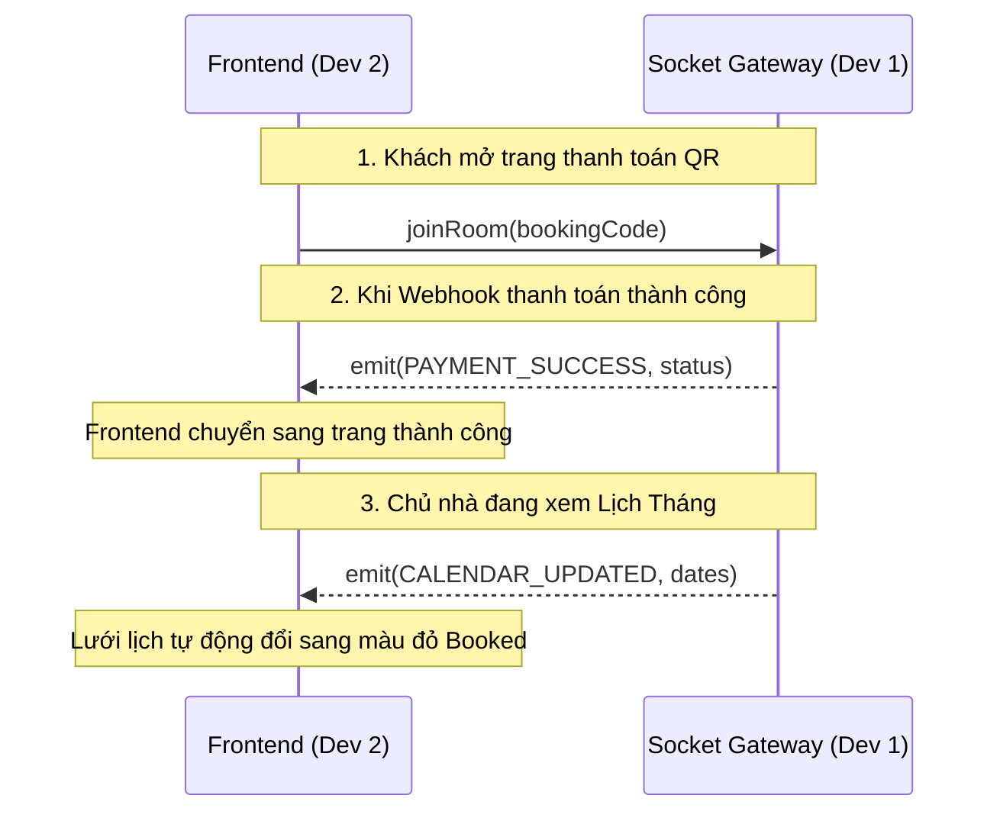
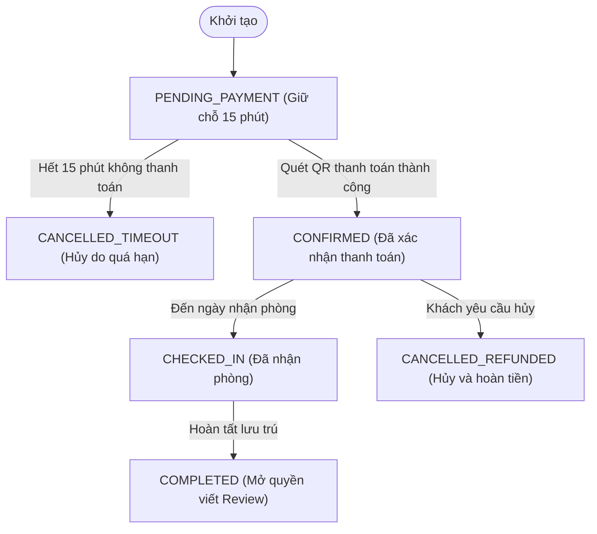
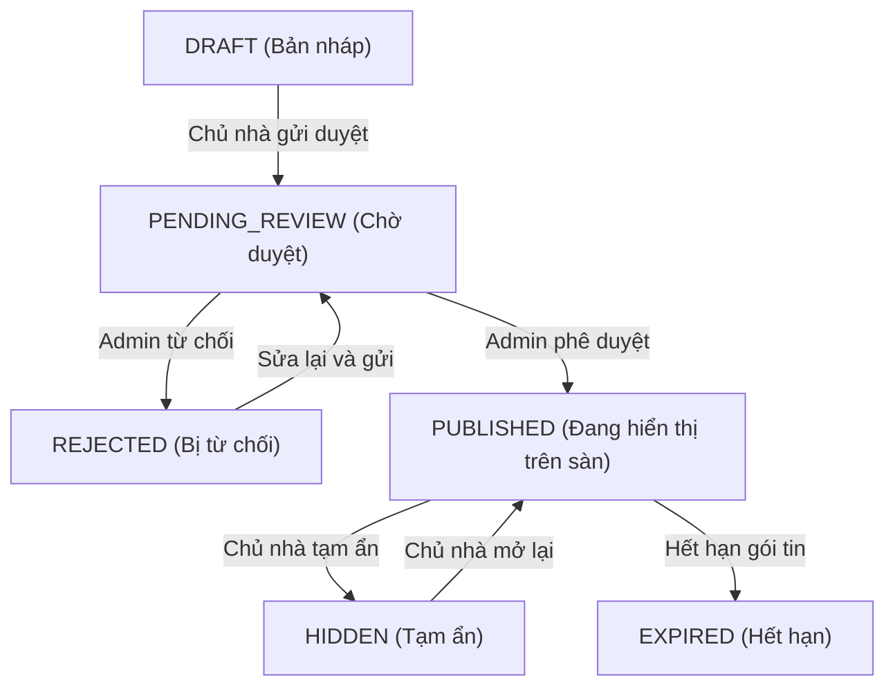

# ĐẶC TẢ GIAO TIẾP API & LUỒNG DỮ LIỆU LIÊN KẾT DEV 1 & DEV 2
## API CONTRACTS, WORKFLOWS & REALTIME SPECIFICATION

> Đây là contract bản phác thảo, chưa đầy đủ để triển khai production. Chuẩn hóa state machine, endpoint, ownership Socket, request-to-book, refund và payout theo [kế hoạch mới, mục 5–6](07_PRODUCTION_DELIVERY_PLAN.md), sau đó xuất OpenAPI và client đồng bộ. Payload/chữ ký webhook phải theo provider thực tế, không dùng mẫu chung dưới đây như đặc tả của nhà cung cấp.

---

## 1. NGUYÊN TẮC THIẾT KẾ REST API

1. **Base URL:** `https://api.domain.vn/api/v1` (hoặc `http://localhost:5000/api/v1` khi dev).
2. **Quy chuẩn Header:**
   - Request Headers: `Content-Type: application/json`, `Authorization: Bearer <access_token>`
3. **Format Response Chuẩn:**
   - **Thành công (200, 201):**
     ```json
     {
       "success": true,
       "message": "Thông báo thân thiện với người dùng",
       "data": { ... },
       "meta": {
         "page": 1,
         "limit": 20,
         "total": 145,
         "totalPages": 8
       }
     }
     ```
   - **Thất bại (400, 401, 403, 404, 409, 500):**
     ```json
     {
       "success": false,
       "errorCode": "ROOM_ALREADY_LOCKED",
       "message": "Phòng này đang có người khác giữ chỗ trong 15 phút.",
       "errors": [
         { "field": "checkInDate", "message": "Ngày nhận phòng không được ở quá khứ" }
       ]
     }
     ```

---

## 2. DANH MỤC API ENDPOINTS CỐT LÕI

### 2.1. Phân Hệ Xác Thực & Người Dùng (Auth Module)

| Method | Endpoint | Mô Tả | Phân Quyền |
|:---:|:---|:---|:---:|
| `POST` | `/auth/register` | Đăng ký tài khoản (Số điện thoại / Mật khẩu / Họ tên) | Public |
| `POST` | `/auth/login` | Đăng nhập hệ thống (Trả về `accessToken`, `refreshToken`, `user`) | Public |
| `POST` | `/auth/send-otp` | Gửi mã xác thực OTP qua SMS/Zalo | Public |
| `POST` | `/auth/verify-otp` | Xác thực mã OTP để kích hoạt tài khoản | Public |
| `POST` | `/auth/refresh-token` | Cấp mới Access Token khi token cũ hết hạn | Public |
| `GET` | `/auth/me` | Lấy thông tin tài khoản hiện tại | User Authenticated |

---

### 2.2. Phân Hệ Phòng Trọ Dài Hạn (Long-term Listing Module)

#### `GET /properties/long-term/search` (Tìm kiếm phòng trọ)
- **Query Params:**
  - `province`: Mã tỉnh thành (VD: `79` - TP.HCM)
  - `district`: Mã quận huyện
  - `minPrice`: Giá tối thiểu (VND)
  - `maxPrice`: Giá tối đa (VND)
  - `minArea`, `maxArea`: Diện tích (m2)
  - `amenities`: Danh sách ID tiện ích cách nhau bởi dấu phẩy (`air_cond,wifi,mezzanine`)
  - `lat`, `lng`, `radius`: Tọa độ tâm và bán kính mét (VD: `lat=10.7725&lng=106.6578&radius=3000` tìm trong 3km)
  - `sortBy`: `price_asc`, `price_desc`, `distance_asc`, `newest`
  - `page`: Trang hiện tại (mặc định 1)
  - `limit`: Số bản ghi mỗi trang (mặc định 20)

#### `POST /properties/long-term` (Chủ trọ đăng tin mới)
- **Request Body (JSON):**
  ```json
  {
    "title": "Cho thuê phòng trọ gác lửng mới xây gần ĐH Bách Khoa",
    "propertyType": "PHONG_TRO",
    "description": "Phòng rộng rãi, giờ giấc tự do, có máy lạnh, kệ bếp...",
    "addressDetail": "268 Lý Thường Kiệt",
    "provinceCode": "79",
    "districtCode": "760",
    "wardCode": "26740",
    "latitude": 10.7725,
    "longitude": 106.6578,
    "monthlyPrice": 3500000,
    "depositAmount": 3500000,
    "areaSqm": 25.5,
    "electricityCost": 3500,
    "waterCost": 20000,
    "waterUnit": "M3",
    "internetCost": 100000,
    "parkingFee": 120000,
    "contactPhone": "0912345678",
    "contactZalo": "0912345678",
    "allowPets": false,
    "amenityIds": ["air_cond", "wifi", "mezzanine", "camera"],
    "imageUrls": [
      "https://r2.domain.vn/uploads/room-1.webp",
      "https://r2.domain.vn/uploads/room-2.webp"
    ]
  }
  ```

#### `POST /appointments` (Khách đặt lịch xem phòng trọ)
- **Request Body (JSON):**
  ```json
  {
    "propertyId": "b18b456e-8ff4-4f24-9b21-4f16bfa09e71",
    "tenantName": "Nguyễn Văn A",
    "tenantPhone": "0987654321",
    "scheduledDate": "2026-10-15",
    "scheduledTime": "15:30:00",
    "notes": "Em muốn xem phòng trực tiếp sau giờ học ạ"
  }
  ```

---

### 2.3. Phân Hệ Homestay & Booking Engine (Short-term Module)

#### `GET /homestays/check-availability` (Kiểm tra phòng trống & Giá)
- **Query Params:** `unitId`, `checkIn` (YYYY-MM-DD), `checkOut` (YYYY-MM-DD), `adults`, `children`
- **Response Success (200):**
  ```json
  {
    "success": true,
    "data": {
      "isAvailable": true,
      "totalNights": 3,
      "priceBreakdown": {
        "nightlyPrices": [
          { "date": "2026-10-20", "price": 600000 },
          { "date": "2026-10-21", "price": 600000 },
          { "date": "2026-10-22", "price": 750000 }
        ],
        "baseAmount": 1950000,
        "cleaningFee": 150000,
        "serviceFee": 95000,
        "totalAmount": 2195000
      }
    }
  }
  ```

#### `POST /bookings/hold` (Khóa giữ phòng & Khởi tạo đơn thanh toán)
- **Request Body (JSON):**
  ```json
  {
    "unitId": "8f7e2a9b-1122-4433-8899-abcdef012345",
    "checkInDate": "2026-10-20",
    "checkOutDate": "2026-10-23",
    "numAdults": 2,
    "numChildren": 0,
    "guestName": "Trần Thị B",
    "guestPhone": "0909123456",
    "guestEmail": "tranb@gmail.com",
    "guestNotes": "Cho mình nhận phòng muộn sau 18:00 nhé"
  }
  ```
- **Response Success (201):**
  ```json
  {
    "success": true,
    "data": {
      "bookingId": "c8d76e54-3210-4abc-9def-123456789abc",
      "bookingCode": "AG-2026-H92X",
      "totalAmount": 2195000,
      "expiresAt": "2026-10-01T14:15:00.000Z",
      "expiresInSeconds": 900,
      "payment": {
        "qrCodeUrl": "https://img.vietqr.io/image/970422-0123456789-compact2.png?amount=2195000&addInfo=AG2026H92X",
        "bankName": "MB Bank",
        "accountNumber": "0123456789",
        "accountName": "CONG TY TNHH HYBRID RENTAL",
        "amount": 2195000,
        "transferContent": "AG2026H92X"
      }
    }
  }
  ```

#### `POST /payments/webhook-ipn` (Cổng thanh toán bắn Webhook)
- **Headers:** `x-signature: <HMAC_HASH>`
- **Request Body:**
  ```json
  {
    "orderCode": "AG-2026-H92X",
    "amount": 2195000,
    "transactionId": "TXN_987654321",
    "status": "PAID",
    "paymentDate": "2026-10-01T14:05:22.000Z"
  }
  ```

---

### 2.4. Phân Hệ Chủ Nhà (Host Portal API)

| Method | Endpoint | Mô Tả |
|:---:|:---|:---|
| `GET` | `/host/calendar/:unitId` | Lấy ma trận lịch tháng (giá từng ngày, trạng thái trống/bị khóa/đã đặt) |
| `PUT` | `/host/calendar/:unitId/pricing` | Cập nhật giá theo khoảng ngày hoặc đổi ngày cuối tuần |
| `POST` | `/host/calendar/:unitId/toggle-block` | Khóa (Block) hoặc Mở khóa (Unblock) dải ngày |
| `GET` | `/host/dashboard/statistics` | Thống kê số lượt xem, tỷ lệ lấp đầy phòng, doanh thu tháng |

---

## 3. ĐẶC TẢ GIAO TIẾP WEBSOCKET REALTIME (SOCKET.IO)

Hệ thống sử dụng WebSocket để phản hồi tức thì giữa Server và Client mà không cần Polling liên tục.

### 3.1. Các Kênh & Sự Kiện (Namespaces & Events)



| Tên Sự Kiện (Event) | Hướng Gửi | Payload | Mục Đích |
|:---|:---:|:---|:---|
| `join_booking_room` | Client -> Server | `{ "bookingCode": "AG-..." }` | Lắng nghe kết quả thanh toán cho đơn cụ thể |
| `PAYMENT_SUCCESS` | Server -> Client | `{ "bookingCode": "...", "status": "CONFIRMED" }` | Báo khách chuyển tiền thành công |
| `NEW_APPOINTMENT` | Server -> Host | `{ "propertyId": "...", "scheduledDate": "..." }` | Báo chủ trọ có người hẹn xem phòng |
| `NEW_CHAT_MESSAGE` | Hai chiều | `{ "conversationId": "...", "message": "..." }` | Gửi và nhận tin nhắn realtime |

---

## 4. BIỂU ĐỒ TRẠNG THÁI NGHIỆP VỤ (STATE MACHINES)

### 4.1. Vòng Đời Đơn Đặt Phòng Homestay (Booking Flow)



### 4.2. Vòng Đời Tin Đăng Bất Động Sản (Property Lifecycle)


