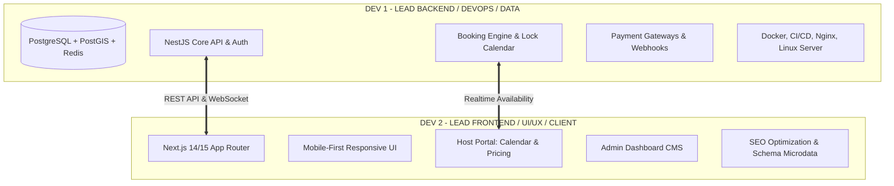

# DỰ ÁN NỀN TẢNG THUÊ PHÒNG TRỌ & ĐẶT PHÒNG HOMESTAY (HYBRID RENTAL PLATFORM)

> **Mô hình kết hợp:** Đăng tin thuê trọ dài hạn (*Nhà Tốt / Chợ Tốt*) + Đặt phòng Homestay ngắn hạn trực tuyến (*Agoda / Airbnb*).

---

## 1. TỔNG QUAN DỰ ÁN

Dự án là nền tảng công nghệ số kết nối **Chủ nhà (Host / Landlord)** và **Khách thuê (Tenant / Guest)** với 2 mô hình kinh doanh song song trên cùng một hệ sinh thái:

1. **Phân hệ Thuê Trọ Dài Hạn (Long-term Rental - Kiểu Nhà Tốt / Phongtro123):**
   - Đăng tin tìm bạn ở ghép, phòng trọ sinh viên, chung cư mini, nhà nguyên căn thuê theo tháng/năm.
   - Hiển thị thông tin minh bạch: Giá thuê hàng tháng, tiền cọc, biểu phí dịch vụ (điện, nước, internet, giữ xe, phí quản lý).
   - Tìm kiếm theo bán kính trường đại học, bệnh viện, khu công nghiệp, trạm metro.
   - Tương tác trực tiếp: Gọi điện, Zalo, Chat realtime trong hệ thống, đặt lịch hẹn xem phòng thực tế.
   - Gói dịch vụ: Tin VIP, đẩy tin, nhãn "Phòng trọ chính chủ đã xác thực".

2. **Phân hệ Homestay / Nghỉ Dưỡng Ngắn Hạn (Short-term Booking - Kiểu Agoda / Airbnb):**
   - Đặt phòng linh hoạt theo ngày/đêm, chọn ngày nhận phòng (Check-in) và trả phòng (Check-out).
   - Quản lý lịch phòng trống linh hoạt (Availability Calendar) và bảng giá theo mùa, cuối tuần, ngày lễ.
   - Đặt phòng tức thì (Instant Book) hoặc Gửi yêu cầu duyệt (Request to Book).
   - Thanh toán trực tuyến đa kênh: VietQR (SePAY/PayOS), VNPAY, MoMo, Thẻ tín dụng/ghi nợ.
   - Quản lý chính sách hủy phòng, giữ tiền đặt cọc tự động, hệ thống đối soát hoa hồng (Commission & Payout).
   - Đánh giá verified review: Chỉ khách đã hoàn thành lưu trú mới được chấm điểm và viết review.

---

## 2. BỘ TÀI LIỆU KẾ HOẠCH & TRIỂN KHAI CHO 2 DEVELOPERS

Hệ thống tài liệu dự án được phân chia thành các file chuyên biệt trong thư mục dự án:

| STT | File Tài Liệu | Nội Dung Chính | Phụ Trách Chính |
|:---:|:---|:---|:---:|
| 1 | [README.md](file:///d:/DuAn_ThueNha/README.md) | Tổng quan, Tech Stack, Kiến trúc, Quy ước Git/Coding | Toàn đội |
| 2 | [01_PROJECT_REQUIREMENTS_SPEC.md](file:///d:/DuAn_ThueNha/01_PROJECT_REQUIREMENTS_SPEC.md) | Đặc tả nghiệp vụ (SRS), Phân hệ User, Luồng Trọ vs Homestay | Toàn đội |
| 3 | [02_SYSTEM_ARCHITECTURE_DATABASE.md](file:///d:/DuAn_ThueNha/02_SYSTEM_ARCHITECTURE_DATABASE.md) | Kiến trúc kỹ thuật, ERD Database, Chống Double-Booking, PostGIS | Dev 1 |
| 4 | [03_IMPLEMENTATION_ROADMAP_SPRINTS.md](file:///d:/DuAn_ThueNha/03_IMPLEMENTATION_ROADMAP_SPRINTS.md) | Lộ trình 10 tuần (5 Sprints), Milestones, KPI nghiệm thu | Toàn đội |
| 5 | [04_DEV1_BACKEND_DEVOPS_PLAN.md](file:///d:/DuAn_ThueNha/04_DEV1_BACKEND_DEVOPS_PLAN.md) | Kế hoạch hành động chi tiết Dev 1 (Backend, Database, DevOps, Payment) | **Dev 1** |
| 6 | [05_DEV2_FRONTEND_UIUX_PLAN.md](file:///d:/DuAn_ThueNha/05_DEV2_FRONTEND_UIUX_PLAN.md) | Kế hoạch hành động chi tiết Dev 2 (Next.js, UI/UX Mobile, Host Portal, Admin) | **Dev 2** |
| 7 | [06_API_SPECS_AND_WORKFLOWS.md](file:///d:/DuAn_ThueNha/06_API_SPECS_AND_WORKFLOWS.md) | Đặc tả REST API, Webhook, State Machine, Luồng Realtime Socket | Dev 1 & Dev 2 |

---

## 3. PHÂN VAI & TRÁCH NHIỆM 2 DEVELOPERS



- **Developer 1 (Backend & DevOps):** Chịu trách nhiệm về "Bộ não & Xương sống" của hệ thống. Đảm bảo dữ liệu an toàn, không bao giờ xảy ra lỗi trùng phòng (Double-Booking), API nhanh dưới 150ms, thanh toán tự động, máy chủ vận hành 24/7 ổn định.
- **Developer 2 (Frontend & UI/UX):** Chịu trách nhiệm về "Bộ mặt & Trải nghiệm khách hàng". Đảm bảo giao diện mượt mà trên điện thoại di động (chiếm 80% traffic thuê nhà), tối ưu chuyển đổi từ xem phòng sang gọi điện / đặt phòng, bảng điều khiển chủ nhà dễ dùng và SEO Google top đầu.

---

## 4. CÔNG NGHỆ ĐỀ XUẤT (TECH STACK)

### Frontend (Khách hàng, Chủ nhà & Quản trị)
- **Framework:** Next.js 14/15 (TypeScript, React 18/19, App Router)
- **Styling & UI Components:** Tailwind CSS, Shadcn UI, Radix UI primitives, Lucide Icons
- **State Management & Data Fetching:** Zustand, TanStack Query (React Query v5)
- **Bản đồ tương tác:** Leaflet / React-Leaflet hoặc Mapbox GL JS (OpenStreetMap base)
- **Calendar & Form:** `react-day-picker` / FullCalendar, `react-hook-form` + `zod`

### Backend & Cơ sở dữ liệu
- **Runtime & Framework:** Node.js + NestJS (hoặc Express.js TypeScript)
- **Database Chính:** PostgreSQL 16 (Tích hợp extension `PostGIS` để tìm kiếm phòng theo bán kính GPS)
- **Cache & Memory Queue:** Redis 7 (Quản lý Cache, Token Blacklist, Distributed Lock Redlock chống double-booking, BullMQ xử lý hàng đợi background)
- **ORM:** Prisma ORM hoặc Drizzle ORM (type-safe, migration mượt mà)
- **Realtime:** Socket.io (Hỗ trợ chat trực tiếp và thông báo trạng thái đặt phòng)

### Lưu trữ & Tích hợp bên thứ 3
- **Lưu trữ hình ảnh/video:** Cloudinary API hoặc AWS S3 / Cloudflare R2
- **Cổng thanh toán:** VietQR (PayOS / SePAY) cho chuyển khoản quét mã QR tự động; VNPAY Sandbox/Production; MoMo API
- **SMS / Email:** SendGrid / Resend (Email hóa đơn, hợp đồng), Zalo ZNS / Twilio / SpeedSMS (OTP đăng nhập, thông báo duyệt tin)

---

## 5. QUY ƯỚC LÀM VIỆC & PHỐI HỢP (WORKING CONVENTIONS)

1. **Quy chuẩn Git:**
   - Nhánh `main`: Production-ready code, chỉ merge qua Pull Request (PR) sau khi Dev 1 & Dev 2 cùng review.
   - Nhánh `develop`: Môi trường staging để test tích hợp.
   - Nhánh tính năng: `feature/d1-booking-engine`, `feature/d2-listing-detail-page`, `fix/...`.
2. **Quy chuẩn API Contract:**
   - Dùng Swagger / OpenAPI tích hợp trong NestJS (`/api/docs`).
   - Mọi API phải có DTO validation rõ ràng (class-validator).
   - Format response chuẩn JSON:
     ```json
     {
       "success": true,
       "data": { ... },
       "message": "Thành công",
       "meta": { "page": 1, "limit": 20, "total": 120 }
     }
     ```
3. **Quy chuẩn Môi trường biến (.env):**
   - Luôn duy trì file `.env.example` cập nhật đầy đủ các key config cần thiết.
